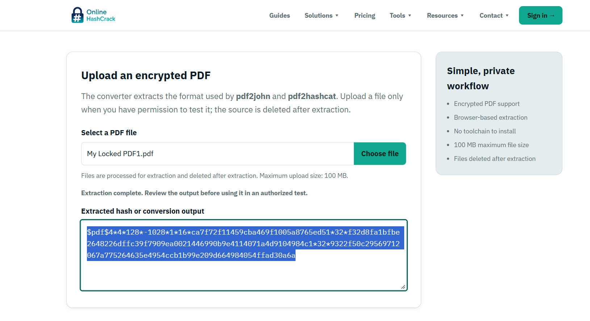
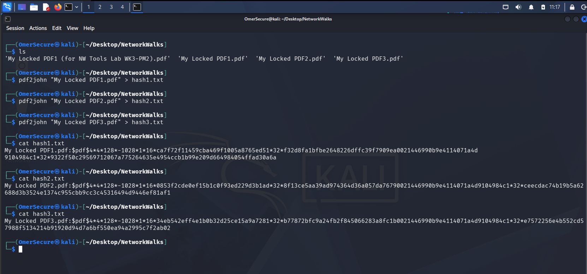
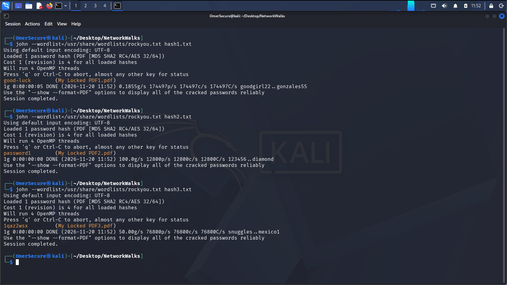
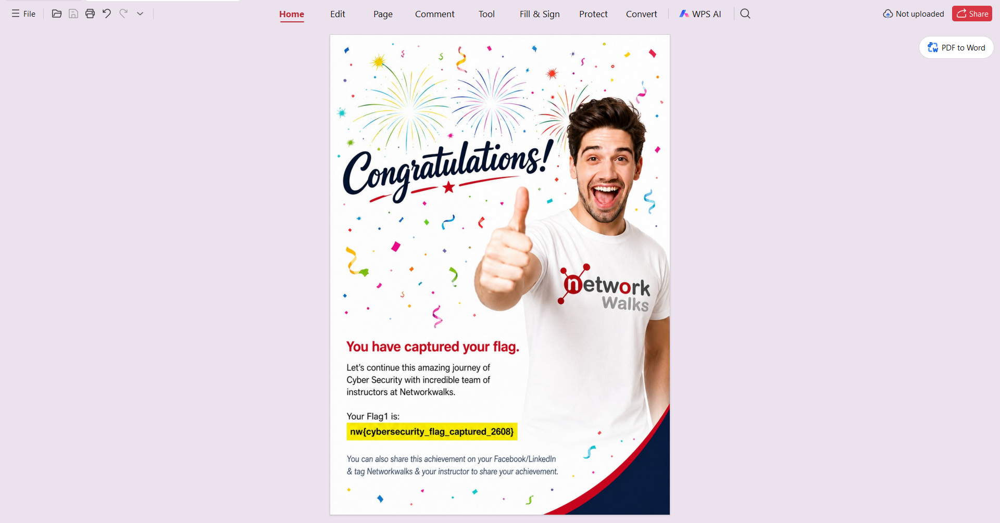
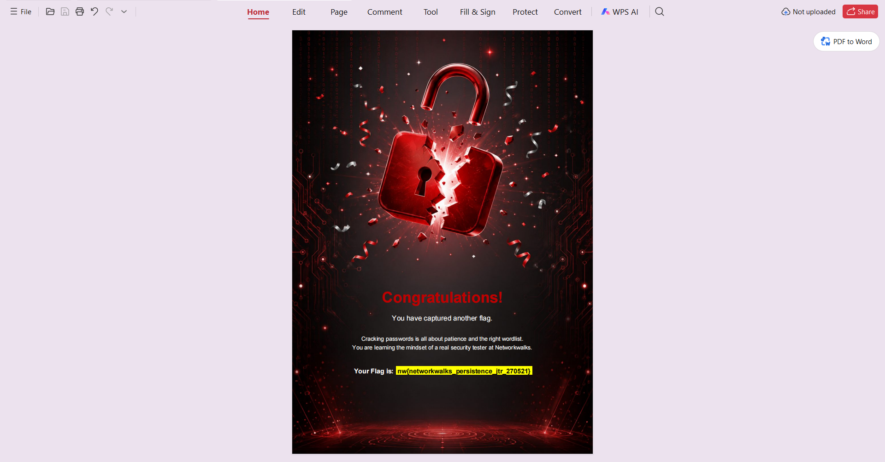
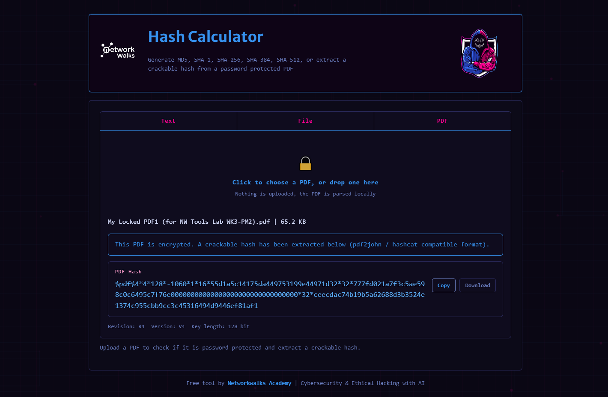
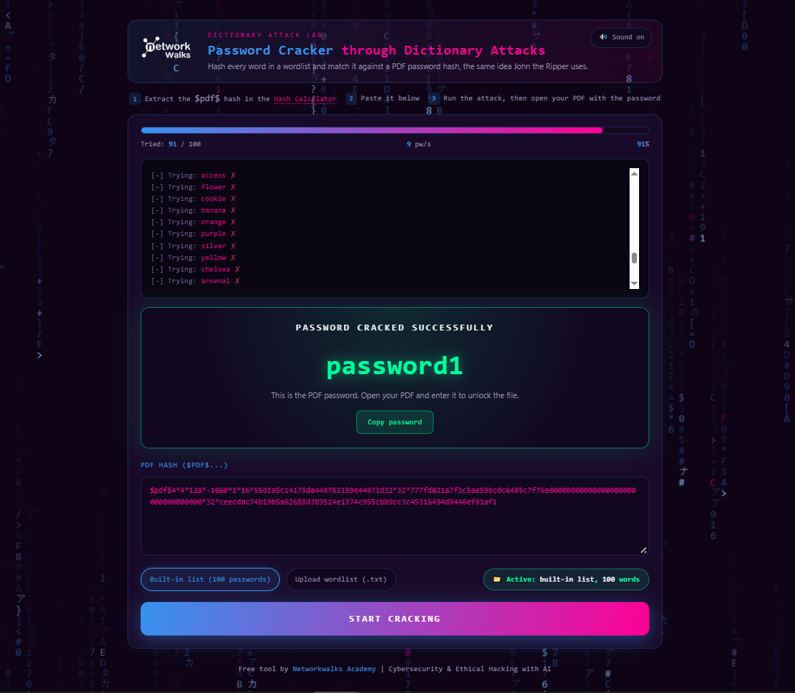
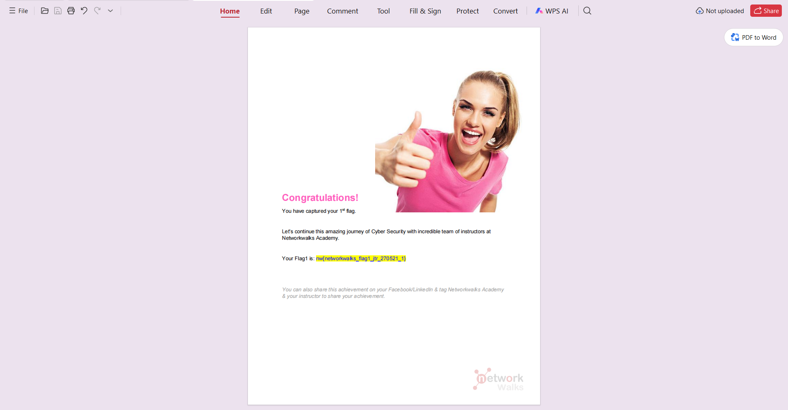

# NETWORKWALKS-OMER-B084-WK3-PM1-PM2-PASSWORD-CRACKING-JTR-NW-TOOLS


## Overview
This repository contains the complete project work for **Week 3** of the Cybersecurity & Ethical Hacking training at NetworkWalks. The project focuses on understanding password-cracking techniques and how password strength affects the security of protected files. The practical work covers required project modules and optional advanced labs.


## Author
- **Name:** Omer Khalid Omer Ali Bawazir
- **Batch:** B084
- **Program:** Cybersecurity & Ethical Hacking
- **Date:** 20 November 2026


## Modules Covered

| Module ID | Title | Tool/Method |
| :--- | :--- | :--- |
| **W3-PM1** | Password Cracking with JTR | John the Ripper (Jumbo) + Johnny GUI |
| **W3-PM2** | Password Cracking with NW Tools | NetworkWalks Hash Calculator & Password Cracker |
| **W3-OPTIONAL1** | AI-Assisted JTR Lab | HexStrike MCP + Claude Desktop |
| **W3-OPTIONAL2** | Mediroza Hospital Portal | Web Application Penetration Testing |

---

## 1. Liability Disclaimer

I have performed these activities only on systems and files provided by NetworkWalks Academy for educational purposes, or on systems I own myself. All materials are for education and research purposes only. The instructor, the authors, and NetworkWalks are not responsible for any misuse of this knowledge. Every action you take is your own responsibility. Misuse can lead to criminal charges, heavy fines, and a permanent record. In most countries, unauthorized access is a crime even when nothing is damaged. All activities were performed within the authorized scope of the assigned educational lab.

---

## 2. Introduction

This report documents the Week 3 practical exercises focused on **password cracking and password recovery for encrypted PDF documents**. The goal was to understand how security professionals test password strength using offline hash-based recovery techniques and to apply that knowledge through two independent toolchains — one local (JTR + Johnny) and one browser-based (NetworkWalks Tools). The exercises demonstrate that weak, predictable, or keyboard-pattern passwords can be recovered quickly, highlighting the importance of long, unique, and unpredictable passwords.

---

## 3. Tools Used

| Tool | Purpose |
| :--- | :--- |
| **John the Ripper (Jumbo)** | Offline password-hash cracking engine |
| **Johnny** | Graphical front-end for John the Ripper |
| **Online Hash Extractor** | Converts an encrypted PDF into a crackable `$pdf$` hash |
| **NetworkWalks Hash Calculator** | Browser-based PDF hash extraction |
| **NetworkWalks Password Cracker** | Browser-based candidate testing engine |
| **HexStrike MCP + Claude Desktop** | AI-assisted automation for password cracking (Optional) |
| **Hydra / Python / Tor** | Tools for the Mediroza Hospital Portal lab (Optional) |

---

## 4. Activities Performed

### 4.1 Module 1: Password Cracking with JTR (W3-PM1)

**Objective:** Recover the password of `My Locked PDF1.pdf` using John the Ripper (Jumbo) and Johnny GUI on a Windows PC.

**Steps Performed:**
1.  **Downloaded and installed** [John the Ripper (Jumbo)](https://www.openwall.com/john) from the official Openwall website.
2.  **Downloaded and installed** [Johnny GUI](https://openwall.info/wiki/john/johnny), the graphical interface for JTR.

> Note: If you are using Kali Linux then you can open JTR (John The Ripper) directly because it comes pre-installed in Kali Linux

<br>

3.  **Extracted the hash** from `My Locked PDF1.pdf` and Save it into a text file named `hash1.txt` for JTR to process.

**Proof of Work:**

3.1 using an [online PDF hash extractor](https://www.onlinehashcrack.com/tools-pdf-hash-extractor.php).



3.2 using Kali-Linux Terminal:
```bash
sudo apt install john -y

pdf2john "My Locked PDF1.pdf" > hash1.txt
pdf2john "My Locked PDF2.pdf" > hash2.txt
pdf2john "My Locked PDF3.pdf" > hash3.txt
```



> Note: If your hash contains extra characters like b' in the start then make sure to remove those when saving in txt file (hash value should be in the format shown in above screenshot i.e. starting with `$pdf$`...).

<br>

4. **Start the attack**

```bash
# using the default wordlist `/usr/share/john/password.lst`
john hash1.txt

# using the specific wordlist like `rockyou.txt`
john --wordlist=/usr/share/wordlists/rockyou.txt hash1.txt

# Show Password after cracking
john --show hash1.txt
```

**Proof of Work:**



<br>

5. **Successfully recovered the passwords for:**
   - My Locked PDF1.pdf: `good-luck`
   - My Locked PDF2.pdf: `password1`
   - My Locked PDF3.pdf: `1qaz2wsx`

<br>

6.  Used the recovered password to open the protected PDF and verified access. The PDF contained a flag confirming successful cracking.

**Proof of Work:**

* **Flag for MyLockedPDF1.pdf** 

* **Flag for MyLockedPDF2.pdf** 
  
* **Flag for MyLockedPDF3.pdf** 


**Finding:** The passwords `good-luck`, `password1`, and `1qaz2wsx` are a weak, common password that was recovered almost instantly by the cracking tool. This demonstrates the risk of using dictionary-based or predictable passwords.


---

### 4.2 Module 2: Password Cracking with NetworkWalks Tools (W3-PM2)

**Objective:** Recover the password of `My Locked PDF1 (for NW Tools Lab WK3-PM2).pdf` using NetworkWalks online browser tools.

**Steps Performed and Proof of Work:**

1.  **Opened** the [NetworkWalks Hash Calculator](https://networkwalks.com/hash-calculator/) tool in a web browser.
2.  **Uploaded the locked PDF file** to the Hash Calculator to extract its hash. The tool generated a crackable hash from the password-protected PDF.



<br>

3.  **Copied the extracted hash and pasted it into** [the NetworkWalks Password Cracker](https://networkwalks.com/password-cracker) tool.
4.  **Initiated the cracking process**. The tool ran a dictionary attack against the hash.
5.  **Successfully cracked the password**: `password1`.



<br>

6.  **Used the recovered password to open the protected PDF and verified access**. The PDF contained a flag confirming successful cracking.

**Proof of Work:**

* **Flag for My Locked PDF1 (For NW Tools Lab WK3-PM2).pdf** 

**Finding:** The same weak password was recovered using browser-based tools, reinforcing the lesson that password strength is the primary defense, regardless of the tool used.


---
<!-- 
### 4.3 Optional Module 1: AI-Assisted JTR Lab (HexStrike MCP + Claude)

**Objective:** Set up HexStrike MCP with Claude Desktop and use AI to automate password cracking with JTR.

**Steps Performed:**
1.  Cloned the HexStrike AI MCP Server repository and installed the required Python dependencies.
2.  Started the HexStrike server locally.
3.  Configured Claude Desktop's `claude_desktop_config.json` to connect to the HexStrike MCP bridge.
4.  Launched Claude Desktop and verified the MCP connection.
5.  Used natural language prompts to instruct Claude to perform password cracking tasks with JTR, demonstrating AI-assisted offensive security automation.

**Finding:** HexStrike MCP enables AI agents to autonomously orchestrate over 150 cybersecurity tools, significantly accelerating workflows like password cracking and vulnerability discovery.

**Proof of Work:**
- [HexStrike MCP Setup](Optional-WK3/AI-JTR-Claude-Hexstrike/screenshots/1-hexstrike-setup.png)
- [AI-Assisted Cracking](Optional-WK3/AI-JTR-Claude-Hexstrike/screenshots/2-ai-cracking.png)

---

### 4.4 Optional Module 2: Mediroza Hospital Patient Portal

**Objective:** Perform authorized penetration testing against the Mediroza Hospital patient portal.

**Steps Performed:**
1.  Conducted reconnaissance to identify the portal's technology stack and endpoints.
2.  Utilized tools such as Hydra, Python scripts, and NetworkWalks tools for password and authentication testing.
3.  Analyzed the portal for common web application vulnerabilities.
4.  Documented findings and potential security risks in a structured format.

**Finding:** (Detailed findings would be documented here based on the specific lab results.)

**Proof of Work:**
- [Mediroza Portal Recon](Optional-WK3/Mediroza-Hospital-Portal/screenshots/1-recon.png)
- [Findings Summary](Optional-WK3/Mediroza-Hospital-Portal/screenshots/2-findings.png)

---
-->

## 5. Summary of Results

| Module | Toolchain | Target File | Recovered Password | Status |
| :--- | :--- | :--- | :--- | :--- |
| **W3-PM1** | John the Ripper + Johnny (Local) | My Locked PDF1.pdf<br>My Locked PDF2.pdf<br>My Locked PDF3.pdf | `good-luck`<br>`password1`<br>`1qaz2wsx` | ✅ Cracked |
| **W3-PM2** | NetworkWalks Hash Calculator + Password Cracker (Web) | My Locked PDF1 (for NW Tools Lab WK3-PM2).pdf | `password1` | ✅ Cracked |

<!-- 
| **W3-OPTIONAL1** | HexStrike MCP + Claude Desktop | My Locked PDF2.pdf | (AI-Assisted) | ✅ Completed |
| **W3-OPTIONAL2** | Hydra / Python / Tor | Mediroza Hospital Portal | (Target-specific) | ✅ Completed |
-->

---

## 6. Key Learnings

1.  **Password Strength is Critical:** Weak, predictable passwords (`password1`) are cracked almost instantly. Password length, uniqueness, and unpredictability are far more important defensive factors than the mere presence of a password.
2.  **Offline Cracking is Powerful:** Once a hash is extracted from a file, an attacker does not need repeated access to the original file. Protecting hashes and encrypted backups matters as much as protecting the passwords themselves.
3.  **Multiple Attack Vectors:** Password cracking can be performed both locally (JTR + Johnny) and via browser-based tools (NetworkWalks), making it accessible to a wide range of skill levels.
4.  **Validation is Essential:** A tool reporting a "successful crack" should always be validated by actually opening the original protected file.
5.  **AI is Changing Security:** AI-powered MCP servers like HexStrike enable automation of complex security workflows, making offensive security tasks faster and more accessible.

---

## 7. Defensive Recommendations

1.  **Use Strong Passwords:** Adopt long, unique, and unpredictable passwords — avoid keyboard patterns and common words.
2.  **Use a Password Manager:** Generate and securely store passwords using a dedicated password manager.
3.  **Enable Multi-Factor Authentication (MFA):** Add an extra layer of security beyond passwords.
4.  **Protect Hashes:** Treat password hashes as sensitive data. Use strong encryption and access controls for backups and credential stores.
5.  **Regular Auditing:** Periodically audit password strength across systems using authorized cracking tools to identify weak credentials before attackers do.
6.  **Stay Updated:** Keep security tools and systems patched and up to date.

---

## 8. Conclusion

During **`Week 3`** of my **Cybersecurity & Ethical Hacking internship**, I completed practical activities covering password cracking and recovery for encrypted PDF files. I used both local tools (John the Ripper + Johnny) and browser-based tools (NetworkWalks Hash Calculator & Password Cracker) to successfully recover passwords from protected files. Additionally, I explored advanced AI-assisted automation with HexStrike MCP and Claude Desktop, and performed web application penetration testing against the Mediroza Hospital portal. These exercises reinforced the importance of strong, unique passwords and demonstrated how security professionals can use these techniques to test and improve organizational security posture. All activities were completed within the authorized scope of the assigned educational lab.

---
<!-- 
## 9. Evidences Collected

### Screenshots

**W3-PM1: JTR + Johnny**
- `screenshots/1-johnny-setup.png`
- `screenshots/2-johnny-cracked.png`
- `screenshots/3-pdf-opened.png`

**W3-PM2: NetworkWalks Tools**
- `screenshots/1-hash-calculator.png`
- `screenshots/2-password-cracker.png`

**Optional Modules**
- `screenshots/1-hexstrike-setup.png`
- `screenshots/2-ai-cracking.png`
-->

